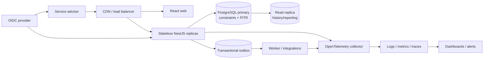

# Built-for-the-Future Engineering Plan

## Current state

The scheduler is a well-scoped modular monolith: React and TanStack Query provide the booking UI, NestJS owns validation and booking rules, and PostgreSQL persists appointments. The strongest design choice is the transaction-level PostgreSQL advisory lock per dealership, followed by an in-transaction availability recheck (`apps/api/src/scheduler.service.ts:165-200`). This prevents two application instances that follow the same code path from assigning the same resource concurrently.

The current implementation is suitable as a challenge demo, not yet as a production multi-dealer service. Reads are unbounded, correctness still depends on every writer using the application lock, startup performs migrations and non-atomic seeding, there is no authentication or dealership authorization, and telemetry is process-local.

| Dimension | Score | Current assessment |
| --- | ---: | --- |
| Scalability | 2/5 | Stateless HTTP and database-backed locking permit multiple app instances, but all writes for one dealership serialize and list/resource queries grow without bounds. |
| Performance | 3/5 | Useful partial appointment indexes exist, but allocation loads all candidates and overlaps, catalog queries are sequential, and the browser downloads/sorts full history. |
| Reliability | 3/5 | Transactions, foreign keys, checks, health checks, and deployment tests are good foundations; idempotency, database overlap constraints, production concurrency tests, and startup safety are missing. |
| Maintainability | 3/5 | Layers, strict TypeScript, migrations, documentation, and E2E coverage are clear; contracts are duplicated, the UI is monolithic, CI is not fully reproducible, and some documentation has drifted. |
| Observability | 2/5 | Correlation IDs, JSON completion logs, basic metrics, and DB readiness exist, but metrics are ephemeral and unscripted, traces are not exported, and business/DB signals and actionable alerts are absent. |

## Key findings

### Scalability

- **Good:** Application state is not used for booking correctness. `pg_advisory_xact_lock(dealershipId)` is held inside the booking transaction, so contention control works across Node processes connected to the same PostgreSQL database (`apps/api/src/scheduler.service.ts:165-200`).
- **Good:** The service is a modular monolith with clear HTTP, domain-service, and persistence boundaries; this is a simpler scaling starting point than premature microservices (`apps/api/src/scheduler.controller.ts:51-94`, `apps/api/src/scheduler.service.ts:49-203`).
- **Risk:** A dealership-wide lock serializes unrelated bookings, including non-overlapping times and different resources (`apps/api/src/scheduler.service.ts:168-171`). A busy dealership becomes a single write lane.
- **Risk:** Appointment history is returned without a date window, limit, or cursor and is sorted in the database; the UI fetches the global list, filters, and sorts it again (`apps/api/src/scheduler.service.ts:62-66`, `apps/web/src/App.tsx:214-217`, `apps/web/src/App.tsx:398-415`).
- **Risk:** Resource selection loads every active bay, every qualified technician, and every overlapping appointment, then performs repeated in-memory scans (`apps/api/src/scheduler.service.ts:92-141`). Runtime grows with both resources and overlapping rows.
- **Risk:** Migrations and seed data run in every web process at startup. The seed's count-then-insert sequence can duplicate data when empty databases receive concurrent starts (`apps/api/src/app.module.ts:15-23`, `apps/api/src/main.ts:6-10`, `apps/api/src/seed.ts:11-55`).

### Performance

- **Good:** Confirmed appointment overlap queries have dealership, bay, and technician partial indexes (`apps/api/src/migrations/1761600000000-InitializeSchema.ts:112-124`).
- **Good:** The client loads catalog and appointments independently and invalidates only appointment data after a successful booking (`apps/web/src/App.tsx:210-217`, `apps/web/src/App.tsx:270-278`).
- **Risk:** Catalog uses four sequential database round trips and always returns every row, including customer records (`apps/api/src/scheduler.service.ts:52-59`).
- **Risk:** The booking overlap query selects complete appointment entities when it only needs occupied bay and technician IDs (`apps/api/src/scheduler.service.ts:114-127`).
- **Risk:** Existing B-tree interval indexes help with dealership and start-time filtering but do not enforce non-overlap and may still scan many historical rows. PostgreSQL range types/GiST should be evaluated with `EXPLAIN (ANALYZE, BUFFERS)`.
- **Risk:** There are no explicit database connection, acquisition, statement, or HTTP request timeouts (`apps/api/src/app.module.ts:13-24`, `apps/web/src/App.tsx:66-82`). A degraded dependency can consume all workers or leave the UI pending.
- **Risk:** The production image copies the build stage's complete `node_modules`, including development dependencies, increasing image size and attack surface (`Dockerfile:1-16`).

### Reliability

- **Good:** Booking rechecks availability and inserts in one transaction; advisory availability is correctly not treated as a reservation (`apps/api/src/scheduler.service.ts:143-162`, `apps/api/src/scheduler.service.ts:164-201`).
- **Good:** Foreign keys, positive duration, valid interval, status checks, and a unique technician-skill pair protect important invariants (`apps/api/src/migrations/1761600000000-InitializeSchema.ts:61-142`).
- **Good:** DTO validation rejects unknown properties and invalid IDs, and timestamps must contain an explicit offset (`apps/api/src/scheduler.controller.ts:16-48`, `apps/api/src/scheduler.service.ts:30-46`).
- **Good:** Render has a DB-backed health endpoint and the local database has a health check (`apps/api/src/scheduler.controller.ts:59-66`, `render.yaml:1-10`, `docker-compose.yml:10-23`).
- **Risk:** Non-overlap is not a database invariant. A script, future endpoint, or service that omits the advisory lock can double-book a bay or technician; current indexes do not prevent it (`apps/api/src/migrations/1761600000000-InitializeSchema.ts:112-124`).
- **Risk:** Appointment creation has no idempotency key. A retry after an ambiguous timeout can create another appointment, potentially using another free resource (`apps/api/src/scheduler.controller.ts:90-93`, `apps/api/src/scheduler.service.ts:164-201`).
- **Risk:** The “concurrent booking” unit test serializes mocked transactions itself, so it does not prove PostgreSQL advisory-lock behavior. E2E tests run one worker and do not send simultaneous create requests (`apps/api/src/scheduler.service.spec.ts:43-143`, `playwright.config.ts:5-10`).
- **Risk:** The API does not enforce opening hours, closures, breaks, leave, bay capabilities, or a maximum booking horizon. These omissions are documented but allow operationally invalid bookings (`README.md:37-40`, `docs/SYSTEM_DESIGN.md:43-46`).
- **Risk:** There is no authentication, dealership-scoped authorization, or data minimization. Catalog and appointment endpoints expose customer names, email addresses, registrations, and history (`apps/api/src/scheduler.controller.ts:75-93`, `apps/api/src/scheduler.service.ts:52-66`, `apps/web/src/App.tsx:619-631`, `apps/web/src/App.tsx:824-831`).
- **Risk:** `DB_SSL=true` disables certificate verification rather than configuring a trusted CA (`apps/api/src/app.module.ts:21-23`).
- **Risk:** Render's free web service can cold-start after inactivity; `render.yaml` provisions only the web service, not PostgreSQL or backup policy (`render.yaml:1-10`). A free Render PostgreSQL database, if used, expires after 30 days.

### Maintainability

- **Good:** Strict TypeScript, versioned migrations with `synchronize: false`, controller/service separation, deterministic first-fit allocation, and accessible UI states make behavior understandable (`apps/api/tsconfig.json:1-16`, `apps/api/src/app.module.ts:19-21`, `apps/api/src/scheduler.service.ts:129-141`).
- **Good:** Playwright tests cover the main booking journey, persistence after reload, full-duration overlap, adjacency, resource constraints, and dealership isolation (`e2e/confirmed-appointment.spec.ts:13-143`, `e2e/real-time-availability.spec.ts:18-194`).
- **Risk:** `BookingDto`, `BookingInput`, frontend payload/types, and E2E types duplicate the same contract and can drift (`apps/api/src/scheduler.controller.ts:22-41`, `apps/api/src/scheduler.service.ts:19-24`, `apps/web/src/App.tsx:20-61`, `e2e/support.ts:7-54`).
- **Risk:** `App.tsx` contains API transport, time conversion, workflow state, lookup logic, validation, and the complete UI in one 1,061-line component (`apps/web/src/App.tsx:1-1061`). Styling is similarly centralized in one large file.
- **Risk:** Entity `status` is a free-form TypeScript string even though the database has a fixed status set (`apps/api/src/entities.ts:178-179`, `apps/api/src/migrations/1761600000000-InitializeSchema.ts:137-141`).
- **Risk:** CI uses `npm install` despite a committed lockfile and does not run the existing formatting check, migration verification, coverage thresholds, dependency review, or static analysis (`.github/workflows/ci.yml:12-40`, `package.json:6-12`).
- **Risk:** Documentation has observable drift: it says the UI sends `Date.toISOString()` and that history is limited to seven/newest first, while the UI sends an explicit local offset and renders the full open-first list (`docs/SYSTEM_DESIGN.md:66-69`, `docs/SYSTEM_DESIGN.md:132-135`, `apps/web/src/App.tsx:133-145`, `apps/web/src/App.tsx:398-415`).

### Observability

- **Good:** API responses receive a validated/generated correlation ID and W3C trace context; completion logs include request, trace, route, status, and duration fields (`apps/api/src/observability.ts:89-137`).
- **Good:** Prometheus-format request, 5xx, and duration metrics are exposed, and readiness verifies the database (`apps/api/src/observability.ts:20-82`, `apps/api/src/scheduler.controller.ts:59-72`).
- **Good:** CI retains traces and screenshots for failed browser tests, and the deployment workflow checks Render deployment status when credentials are configured (`playwright.config.ts:12-18`, `.github/workflows/render-deployment.yml:23-73`).
- **Risk:** Metrics live in a process-local `Map`, reset at restart, and fragment across replicas. No scrape target or metrics backend is configured (`apps/api/src/observability.ts:21-82`, `render.yaml:1-10`).
- **Risk:** A `traceparent` response is produced, but no spans are exported and database operations are not instrumented; this is context propagation, not distributed tracing (`apps/api/src/observability.ts:94-108`).
- **Risk:** Logs capture completed responses but not aborted requests, exception details, release version, instance, deployment SHA, or business outcomes such as availability conflicts and bookings (`apps/api/src/observability.ts:109-137`).
- **Risk:** There are no DB pool, advisory-lock wait, query latency, appointment conflict, idempotency replay, or booking-success metrics.
- **Risk:** The documented SLO and alert policy is aspirational; no monitoring or paging configuration implements it (`docs/SYSTEM_DESIGN.md:145-149`). A six-hour scheduled health check is deployment evidence, not operational monitoring (`.github/workflows/render-deployment.yml:1-6`).

## Roadmap

Phase 0 and the code-level parts of Phase 1 are implemented in this repository. OpenID Connect, a managed telemetry backend, and stored `EXPLAIN` output at production volume are still open; the demo uses signed bearer tokens, optional OTLP export, and the query shapes in `docs/query-plans.md`.

### Phase 0 — Challenge hardening (days)

- [x] **Prove concurrency against PostgreSQL** — run simultaneous creates against the real Compose database, assert one success/one conflict, and test two non-conflicting bookings. **Why:** reliability. **Effort:** S. **Acceptance:** the test fails when the advisory lock is removed and is required by CI.
- [x] **Make CI deterministic** — use `npm ci` in CI and Docker, run `format:check`, publish Playwright artifacts, and add a migration-up smoke test. **Why:** reliability, maintainability. **Effort:** S. **Acceptance:** clean checkout produces identical dependency versions; formatting and migration failures block merge.
- [x] **Bound dependency waits** — configure validated production environment variables, PostgreSQL connect/acquire/statement timeouts, and client request cancellation. **Why:** reliability, performance. **Effort:** S. **Acceptance:** unavailable PostgreSQL produces a bounded 503/startup failure; UI exits pending state within the documented timeout.
- [x] **Remove startup races** — make demo seeding explicitly opt-in and idempotent; document that production migrations run as a release/pre-deploy job rather than in each replica. **Why:** scalability, reliability. **Effort:** S. **Acceptance:** two simultaneous starts on an empty database create exactly one seed set and only one migration runner is used in production.
- [x] **Add idempotent create semantics** — accept an idempotency key, persist request hash/result under a unique constraint, and return the original response for a valid replay. **Why:** reliability. **Effort:** M. **Acceptance:** repeated and concurrent requests with one key create one appointment; reuse with a different body returns 409.
- [x] **Add database non-overlap protection** — use PostgreSQL range/exclusion constraints for confirmed appointments by bay and technician, translating constraint violations to 409. **Why:** reliability, data integrity. **Effort:** M. **Acceptance:** direct SQL and application writes cannot create overlapping confirmed assignments; adjacent intervals remain valid.
- [x] **Correct claims and limitations** — align system-design text with the current timestamp conversion/list behavior and state explicitly that metrics/tracing/alerts are not yet durable. **Why:** maintainability, observability. **Effort:** S. **Acceptance:** every “implemented” claim has a source or automated check.
- [x] **Expose deployment identity** — add service version/commit to logs and a non-sensitive info/readiness response; document Render cold starts and database lifecycle. **Why:** observability, reliability. **Effort:** S. **Acceptance:** an incident responder can map a response/log to the deployed commit.

### Phase 1 — Safe team rollout (weeks)

- [x] **Introduce identity and dealership scope** — demo HMAC bearer tokens, advisor/coordinator roles, API authorization guards, and catalog responses without customer email. **Why:** reliability/security, maintainability. **Effort:** L. **Acceptance:** authorization tests prove an advisor cannot book another dealership. OpenID Connect is still the production design in `docs/SYSTEM_DESIGN.md`.
- [x] **Paginate and filter history** — cursor pagination with required dealership/date windows and a matching virtualized or incremental UI. **Why:** scalability, performance. **Effort:** M. **Acceptance:** response time and memory stay within targets with one million appointments; no endpoint can return an unbounded history.
- [x] **Move allocation into bounded SQL** — select only the first free compatible bay/technician with indexed anti-joins or `NOT EXISTS`; validate plans with production-shaped data. **Why:** performance, scalability. **Effort:** M. **Acceptance:** p95 availability and booking meet 300/500 ms targets at the agreed load and scans remain bounded.
- [x] **Complete supporting indexes** — partial indexes for active bays and technicians, a service-skill index, a history index, and GiST exclusion indexes. **Why:** performance. **Effort:** S/M. **Acceptance:** query shapes are in `docs/query-plans.md`. `EXPLAIN (ANALYZE, BUFFERS)` at production volume is still to be captured.
- [x] **Create one versioned API contract** — `contracts/openapi.json` is checked against the API document in CI. The web client and Playwright helpers share `contracts/types.ts`. **Why:** maintainability, DX. **Effort:** M. **Acceptance:** a contract drift fails `npm test`. A decorator-generated client is not used.
- [x] **Split application modules** — diary, sign-in, API client, and time conversion live outside `App.tsx`. Diary ordering and the client are tested without rendering the page. **Why:** maintainability. **Effort:** M. **Acceptance:** `npm run test:web` covers them, and Playwright imports the same time helpers.
- [x] **Install durable telemetry** — structured logs, booking and lock-wait metrics, authenticated `/api/metrics` in production, and OTLP JSON export when `OTEL_EXPORTER_OTLP_ENDPOINT` is set. **Why:** observability. **Effort:** M. **Acceptance:** one correlation/trace id is logged on the HTTP request, the booking span, and the outcome. A managed backend and dashboards are not deployed.

### Phase 2 — Production readiness (months)

- [ ] **Model operating calendars and capabilities** — dealership IANA timezone, opening intervals, holidays, technician leave/breaks, bay maintenance, and service capability requirements. **Why:** reliability, product correctness. **Effort:** L. **Acceptance:** DST, closure, partial-overlap, and capability matrix tests pass; invalid slots cannot be persisted.
- [ ] **Add lifecycle APIs** — versioned rescheduling, cancellation with reason/idempotency, immutable audit records, and optimistic concurrency. **Why:** reliability, maintainability. **Effort:** L. **Acceptance:** stale updates return 412, cancellations release capacity atomically, and every mutation has actor/prior/new values.
- [ ] **Separate transactional side effects** — transactional outbox plus workers for notifications and downstream integration; retries with dead-letter handling. **Why:** reliability, scalability. **Effort:** L. **Acceptance:** booking does not depend on email/integration availability; events are delivered at least once and consumers are idempotent.
- [ ] **Harden data operations** — managed PostgreSQL with PITR, encrypted backups, restore drills, connection-pool sizing, migration rollback/runbooks, and retention/anonymization jobs. **Why:** reliability, compliance. **Effort:** L. **Acceptance:** quarterly restore meets RPO 5 minutes/RTO 30 minutes; retention jobs and legal holds are audited.
- [ ] **Establish release safety** — staged deploys, backwards-compatible expand/contract migrations, smoke tests, rollback automation, dependency/container scanning, and SBOM generation. **Why:** reliability, maintainability. **Effort:** M. **Acceptance:** a failed canary automatically stops rollout; rollback is rehearsed and documented.
- [ ] **Prove capacity and failure behavior** — load, soak, lock-contention, failover, and dependency-latency tests at 150% of forecast. **Why:** all dimensions. **Effort:** M/L. **Acceptance:** targets hold for 50 dealerships, 200 active advisors, 20 booking attempts/second bursts, and five million retained appointments.

### Phase 3 — Multi-dealer/high-volume evolution (long term)

- [ ] **Partition by tenant and time** — make `dealershipId` mandatory in every access path and evaluate appointment partitioning/archival once measured data volume warrants it. **Why:** scalability, data isolation. **Effort:** L. **Acceptance:** tenant-scoped queries prune partitions and authorization tests remain mandatory.
- [ ] **Reduce hotspot locking** — measure per-dealership advisory-lock wait, then consider resource/time-bucket locks or database-first allocation while preserving exclusion constraints. **Why:** scalability, performance. **Effort:** L. **Acceptance:** hot-dealer throughput increases without double booking; lock p99 remains below the agreed budget.
- [ ] **Scale reads deliberately** — cache stable catalog/configuration data with explicit invalidation and use read replicas only for stale-tolerant history/reporting. Never cache authoritative booking availability. **Why:** scalability, performance, reliability. **Effort:** M/L. **Acceptance:** booking reads remain on the primary; measured primary read load falls without stale allocation decisions.
- [ ] **Add regional/tenant placement only when required** — route dealers to a home region/database and keep each appointment transaction single-region. **Why:** scalability, resilience. **Effort:** L. **Acceptance:** documented tenant placement, failover, data residency, and recovery behavior meet product requirements.

## Target architecture

The target remains a modular monolith on the synchronous booking path. Replicas are stateless; PostgreSQL is the authority for allocation and non-overlap. Workers handle side effects, not booking correctness.

### Key decisions and trade-offs

- **Keep the modular monolith until evidence justifies extraction.** It preserves transaction boundaries and lowers operational burden; modules and contracts create future seams.
- **Enforce correctness twice.** Application allocation provides useful errors and deterministic assignment; database exclusion/unique constraints protect against every writer.
- **Use dealership as the tenant and contention boundary.** It is simple and aligns with authorization, but hot dealerships require measured lock refinement.
- **Do not cache availability.** Cache stable catalog/configuration only; confirmation always rechecks the primary database.
- **Use UTC instants plus dealership IANA timezone.** `timestamptz` stores instants; policy evaluation uses the dealership timezone and timezone database.
- **Keep booking synchronous; make side effects asynchronous.** The caller receives a durable booking result while notifications/integrations retry independently through an outbox.
- **Prefer cursor/date-window pagination.** Offset pagination degrades and shifts under concurrent writes; cursors provide stable traversal.
- **Separate liveness from readiness.** Liveness reports process health; readiness includes database and migration compatibility so traffic drains without restart loops.

## Observability plan

### Logs

- Emit structured JSON through a logger rather than direct `console.log`.
- Required fields: timestamp, level, service, environment, version/commit, instance, request ID, trace/span IDs, route template, status, duration, dealership ID when authorized, and error code/class.
- Emit explicit events for availability result, booking confirmed/conflicted, idempotency replay, authorization denial, migration, shutdown/drain, and outbox delivery.
- Exclude customer names, emails, registrations, tokens, request bodies, and connection strings. Centralize logs with retention and access controls.

### Metrics

- HTTP RED: request rate, error rate, duration by route/method/status class.
- Booking: checks, available/unavailable results, confirmations, conflicts, idempotency replays, and allocation failures by dealership tier—not customer or unbounded IDs.
- PostgreSQL: pool active/idle/waiting, acquisition/query latency, timeouts, deadlocks, replica lag, storage/CPU/IOPS, and migration state.
- Contention: advisory-lock wait/hold histograms and exclusion-constraint conflicts.
- Runtime: event-loop lag, heap, GC, CPU, restarts, readiness, and deployment version.
- Use OpenTelemetry/Prometheus-compatible instruments exported to a durable backend; do not rely on per-process counters.

### Traces

- Instrument inbound HTTP, controller/service operations, TypeORM/PostgreSQL calls, lock acquisition, transaction, and outbox publish/consume.
- Continue incoming W3C context and return correlation IDs. Use head sampling plus tail/error sampling; never attach PII or raw SQL parameters.
- Preserve traces across workers and downstream integrations using trace context in outbox event metadata.

### SLIs, SLOs, and alerts

- **Availability:** 99.9% successful, valid requests monthly for availability and booking, excluding user 4xx but including server conflicts caused by defects.
- **Latency:** p95 under 300 ms for catalog/availability, p95 under 500 ms for booking, p99 under 1 second.
- **Correctness:** zero confirmed overlapping bay/technician assignments; zero duplicate appointments for one idempotency key.
- **Freshness:** 99.9% of successful bookings visible in history within 2 seconds; 99% of outbox events delivered within 60 seconds.
- Use multi-window burn-rate alerts for the availability SLO. Page on database unavailability, correctness-constraint violations, sustained 5xx/latency burn, exhausted pools, or outbox backlog breaching its SLO. Ticket on capacity trends, backup/restore failures, certificate expiry, and dependency vulnerabilities.
- Every alert links to a runbook and dashboard filtered by environment, service version, region, and time range. Review alert usefulness after incidents and quarterly game days.

## Risks and open questions

- What is the authoritative tenant model: dealership, dealer group, or market? This determines authorization, partitioning, and data residency.
- What booking throughput and resource counts are expected per dealership, especially the largest one? Lock strategy should change only after measuring contention.
- Must one vehicle be restricted from overlapping appointments, in addition to bay and technician?
- Are services tied to particular vehicle models, technicians, bay capabilities, parts availability, or lead times?
- What are the exact rules for business hours, breaks, holidays, DST ambiguity, late arrival, overrun, cancellation, and rescheduling?
- Is first-fit assignment acceptable, or must the system optimize fairness, continuity, utilization, travel, or customer preference?
- Which responses need customer PII, who may export it, and what regional retention/erasure rules apply?
- What are the source systems for customers, vehicles, technicians, and dealer configuration, and which system wins reconciliation conflicts?
- What deployment and database plans are funded? Render free-tier cold starts and expiring free databases cannot satisfy the stated SLO/RPO/RTO.
- Is active-active regional booking required? If not, single-writer regional placement is materially simpler and safer.
