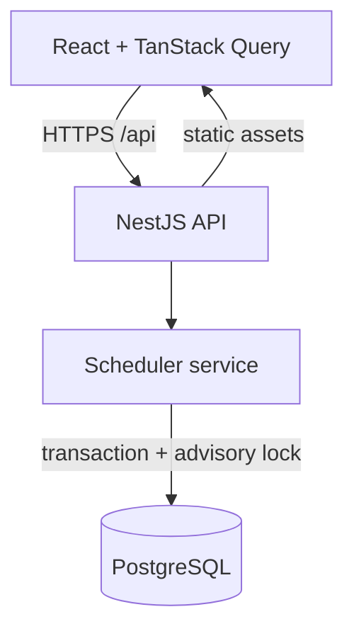

# System Design — Unified Service Scheduler

## Architecture

## Responsibilities

React provides appointment entry, resource availability status, confirmation, and appointment history. TanStack Query handles API request state and cache invalidation. NestJS validates requests and invokes service logic. TypeORM maps customers, vehicles, dealerships, technicians, technician skills, service bays, service types and appointments. PostgreSQL stores confirmed bookings and enforces transaction serialization.

## Booking flow

1. Choose dealership, vehicle, service type and timezone-aware desired start.
2. Fetch service duration and candidate bays/qualified technicians.
3. Check existing confirmed bookings using half-open intervals: `existing.start < requested.end AND existing.end > requested.start`.
4. Availability endpoint returns advisory results without reserving resources.
5. Booking endpoint begins a transaction and obtains `pg_advisory_xact_lock(dealershipId)`; it rechecks availability and persists appointment references before commit. Conflicts yield HTTP 409.
6. The UI refreshes the appointment list.

## Technology rationale

A modular monolith minimizes distributed-system complexity for a small challenge while preserving layers. NestJS provides dependency injection and REST composition. React + TanStack Query separate remote state from UI. PostgreSQL provides transactional correctness. Docker provides deployment parity.

## Observability

NestJS structured logs (stdout) and Render build/runtime logs are the basic observability mechanism. `GET /api/health` enables health checks. A production extension should add correlation IDs, request durations, error metrics, tracing, and actionable alerts.

## Assumptions and limits

The sample vehicle belongs to a seeded customer. Each service type has a duration and technician qualification. Booking availability is dealership-specific. All timestamps represent instants. Business hours, breaks, bay suitability rules, appointment editing, authentication, authorization and PII protection would be required for a production rollout. ORM schema synchronization is used for the demo only.

## GenAI design collaboration

AI supported initial data modeling, layer boundaries, API design and identifying double-booking as a principal risk. Generated output is subject to engineering review, particularly the race between availability and confirmation. Per-dealership PostgreSQL advisory transaction locks are used as a straightforward contention-control strategy for this small service. Unit and integration/concurrency tests should be extended and executed in CI before real usage.