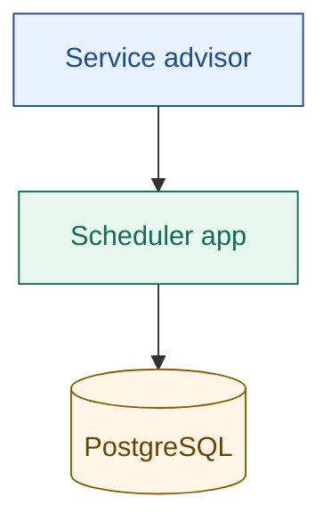
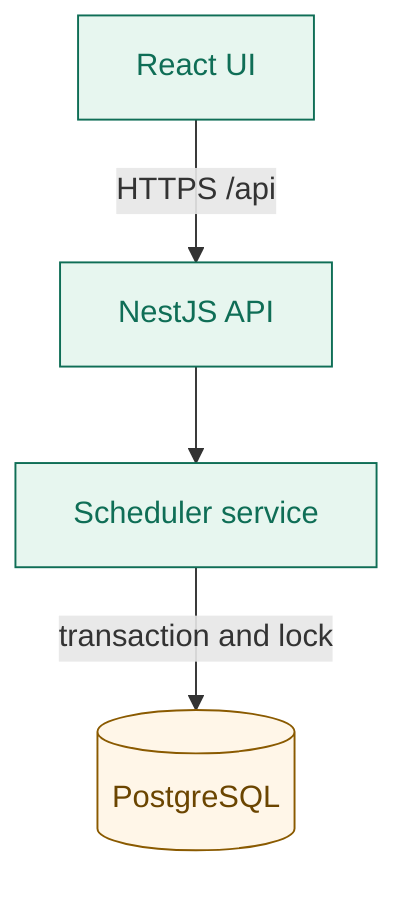
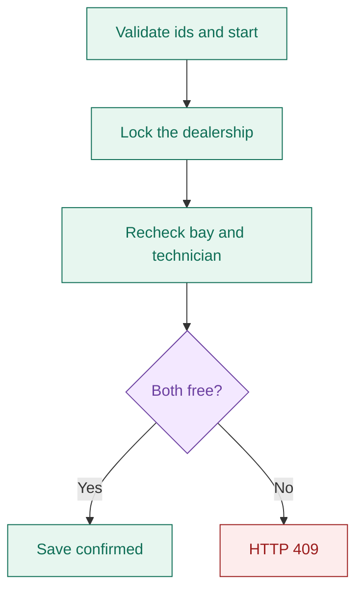
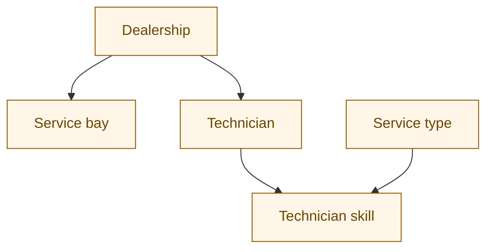
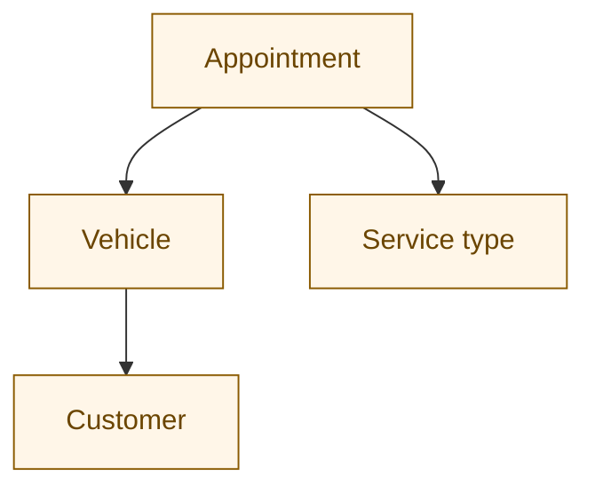

# System Design — Unified Service Scheduler

The shipped demo is a modular monolith: a React client, a NestJS API, and PostgreSQL, packaged as one Docker image. This page is the design of that system. Statements below come from this document's previous scope, the README, and the code they describe. Anything those sources leave undecided is marked **Gap**.

The running demo is [https://keyloop-service-scheduler-29lh.onrender.com/](https://keyloop-service-scheduler-29lh.onrender.com/). `GET /api/health` on that host returns `{"status":"ok"}`.

## 1. Purpose

A service advisor books a vehicle into a dealership for a timed service. The system must show whether a bay and a qualified technician are free, then confirm the appointment without giving the same bay or the same technician to two overlapping bookings.

## 2. Context

The advisor uses a browser. The scheduler application is the only system in the demo. PostgreSQL is the system of record for confirmed bookings.

**Legend.** Blue is a person, green is the application, amber is stored data. Later diagrams use the same colors. Purple is a decision. Red is a rejected booking.

## 3. Scope

In scope for the demo:

- Choose a dealership, a seeded vehicle, a service type, and a timezone-aware start.
- Advisory availability for that dealership, without holding the bay or the technician.
- A confirmed appointment stored in PostgreSQL.
- A list of appointments in the UI, refreshed after a successful booking.

Out of scope, and not designed here: business hours, breaks, bay suitability, appointment edits, cancellations, holidays, authentication, authorization, and protection of personal data. See [section 10](#10-open-gaps).

## 4. Architecture

One NestJS process serves the API and the built React assets. A scheduler service owns booking rules. TypeORM maps the tables. PostgreSQL stores confirmed bookings and is the serialization point.

The same process serves the static React build. That response is not drawn as a second arrow, so the request path stays one way.

| Part | Responsibility |
| --- | --- |
| React | Appointment entry, availability, confirmation, and history. |
| TanStack Query | Request state, and cache invalidation for the appointment list after a confirmed booking. |
| NestJS | Validate the request body and call the scheduler service. |
| TypeORM | Map dealerships, customers, vehicles, service types, bays, technicians, technician skills, and appointments. |
| PostgreSQL | Store confirmed bookings. Serialize booking transactions. |
| Docker | Same image locally (`docker compose up --build`, port 3000) and on Render. |

A modular monolith is the chosen shape: it avoids network calls between services for a small challenge, and it keeps a UI layer, an API layer, and a service layer. NestJS supplies dependency injection and the REST surface. React and TanStack Query keep remote state out of the component's own bookkeeping. PostgreSQL supplies transactional correctness.

## 5. Booking

Desired start is an instant. The UI reads a local date-time and sends UTC via `Date.toISOString()`. The service treats the stored `timestamptz` values as instants.

Overlap is half-open. An existing confirmed appointment conflicts when `existing.start < requested.end` and `existing.end > requested.start`. Touching endpoints do not conflict: 10:00–11:00 may sit beside 11:00–12:00. The unit test in `apps/api/src/scheduler.service.spec.ts` covers that pair of cases. Only rows with status `confirmed` at the same dealership are considered.

Duration comes from the service type. The requested end is start plus `durationMinutes`. Candidate resources are active bays at that dealership, and active technicians at that dealership who have a skill row for that service type. The service takes the first free bay and the first free technician in ascending id order.

1. The advisor chooses dealership, vehicle, service type, and start.
2. Availability loads the service duration and the candidate bays and qualified technicians. It does not take a lock and it does not insert a row. The result is advisory.
3. The overlap test above decides whether each candidate is free for the whole interval.
4. Booking opens a `READ COMMITTED` transaction and takes `pg_advisory_xact_lock(dealershipId)`. The lock is held until the transaction ends, so two bookings for the same dealership cannot both pass the recheck.
5. Inside the lock the service loads the vehicle, the service type, and the free bay and technician again. It refuses the booking when either resource is missing.
6. On success it inserts one appointment: the vehicle's customer, the chosen bay and technician, the computed end, and status `confirmed`. The UI then invalidates the appointment query and reloads the list.

A conflict throws NestJS `ConflictException` with the message `Technician or service bay unavailable for entire appointment`, which the API returns as HTTP 409. Unknown dealership, vehicle, or service type is HTTP 404. Identifiers must be integers greater than zero.

The availability response includes `available`, `startAt`, `endAt`, `durationMinutes`, `serviceBay`, and `technician`. Either resource is null when that side is busy. `available` is true only when both are present.

## 6. Data

TypeORM creates and alters tables at startup (`synchronize: true` in `apps/api/src/app.module.ts`). Relationships are integer columns on the entities. The entity classes do not declare foreign keys.

An appointment also stores `dealershipId`, `serviceBayId`, `technicianId`, `startAt`, `endAt`, and `status`. The customer on the appointment is copied from the vehicle at booking time. The advisor does not pick a customer separately.

Seed data is illustrative and is inserted only when the dealership table is empty (`apps/api/src/seed.ts`):

- Two dealerships, both in Ho Chi Minh City.
- One customer, `demo@example.com`, who owns both sample vehicles.
- Three service types: 60, 90, and 120 minutes.
- Two active bays and two active technicians per dealership. Each technician is skilled for every service type.

## 7. Interfaces

The controller is `apps/api/src/scheduler.controller.ts`. JSON field names on a booking body are `dealershipId`, `vehicleId`, `serviceTypeId`, and `startAt`. Extra fields are rejected.

| Method | Path | Behavior |
| --- | --- | --- |
| `GET` | `/api/health` | Returns `{"status":"ok"}`. Does not query PostgreSQL. |
| `GET` | `/api/catalog` | Dealerships, customers, vehicles, and service types. |
| `POST` | `/api/availability` | Advisory check. No lock and no insert. |
| `POST` | `/api/appointments` | Book inside the dealership lock, or HTTP 409. |
| `GET` | `/api/appointments` | Stored appointments, oldest start first. The query does not filter on status. Optional `dealershipId` query. |

The UI loads the catalog and the full appointment list. It does not pass `dealershipId`. The history panel shows up to seven appointments, newest first, with vehicle, bay, and technician ids.

Example body from the README: `{"dealershipId":1,"vehicleId":1,"serviceTypeId":1,"startAt":"2026-12-01T09:00:00+07:00"}`.

## 8. Deployment and observability

`Dockerfile` builds the web app and the API, then runs `node dist/main.js` on port 3000 with the React build in `public`. Compose starts PostgreSQL 17 and the app. The app waits until Postgres is accepting connections.

Render runs that image as the web service `keyloop-service-scheduler` in Singapore on the free plan (`render.yaml`). The platform health check uses `/api/health`. `DATABASE_URL` is set in the Render environment to the database internal URL and is not stored in this repository. When `DB_SSL=true`, the client uses TLS and does not verify the server certificate. `render.yaml` does not set that variable.

NestJS writes its process log to stdout. Render keeps build and runtime logs. Those two streams are the observability the demo has. `GET /api/health` is the liveness signal.

CI on GitHub Actions runs the Jest suite, the TypeScript build, and a Docker image build. A second workflow monitors the Render service; Render itself deploys pushes to `main`.

## 9. Decisions

| Topic | Decision |
| --- | --- |
| Shape | Modular monolith. One deployable process. |
| Contention | One PostgreSQL advisory transaction lock per dealership, then a recheck. Chosen as a direct control for this small service, aimed at the race between the advisory check and confirm. |
| Isolation | `READ COMMITTED` plus that lock. The lock, not the isolation level alone, stops two overlapping confirms for one dealership. |
| Overlap | Half-open interval. Adjacent appointments are allowed. |
| Assignment | Lowest id among active, skilled, non-overlapping resources. |
| Schema changes | TypeORM `synchronize: true` for the demo. |
| Time | Instants in `timestamptz`. The client converts local input to UTC. |

## 10. Open gaps

> **Gap.** No latency, availability, recovery, or capacity target is stated.

> **Gap.** Business hours, breaks, bay suitability, appointment editing, cancellations, holidays, authentication, authorization, and personal-data protection are named as production needs and are not designed.

> **Gap.** Production schema change is not designed beyond the note that `synchronize: true` must be replaced with versioned migrations and stronger database constraints. Foreign keys are not declared.

> **Gap.** The design does not say which free technician or bay should be chosen. The service uses ascending id.

> **Gap.** `validStart` in `apps/api/src/scheduler.service.ts` compiles a pattern whose digit tokens are escaped twice, so a normal ISO 8601 instant does not match. The UI sends `Date.toISOString()`, which is that form and also includes milliseconds the pattern does not describe. Availability and booking then fail the start check before the overlap rule runs.

> **Gap.** Correlation ids, request durations, error metrics, tracing, and actionable alerts are named as a production extension. They are not built. The health check does not query the database.

> **Gap.** The automated test proves adjacent slots do not overlap. It does not run two concurrent bookings. The design asks for that coverage, in CI, before real use.

## 11. GenAI collaboration

AI was used to outline the architecture and to draft the initial data model, layer boundaries, API, concurrency approach, Docker setup, documentation, and React UI. Generated output stays subject to engineering review. The review focus is the race between availability and confirmation, transaction isolation, resource overlap, date-time validation, input validation, the Postgres connection, and deployment verification.

Per-dealership advisory transaction locks are the contention control adopted for this service. Failed installs, deployment errors, and later changes belong in the presentation as open items, not as validated behavior.

## Source map

| Claim | Source |
| --- | --- |
| Layers, lock, half-open overlap, advisory check, 409, health, demo limits | This design, checked against `apps/api/src/scheduler.service.ts` and `scheduler.controller.ts` |
| Entities and the absence of foreign keys | `apps/api/src/entities.ts` |
| Schema sync and static files | `apps/api/src/app.module.ts` |
| Seed contents | `apps/api/src/seed.ts` |
| UI behavior | `apps/web/src/App.tsx` |
| Adjacent-slot test | `apps/api/src/scheduler.service.spec.ts` |
| Image and local runtime | `Dockerfile`, `docker-compose.yml` |
| Render service, region, health path | `render.yaml`, `README.md` |
