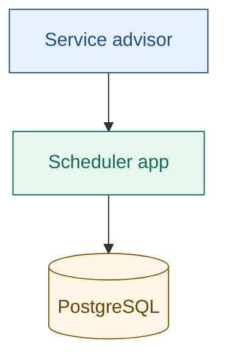
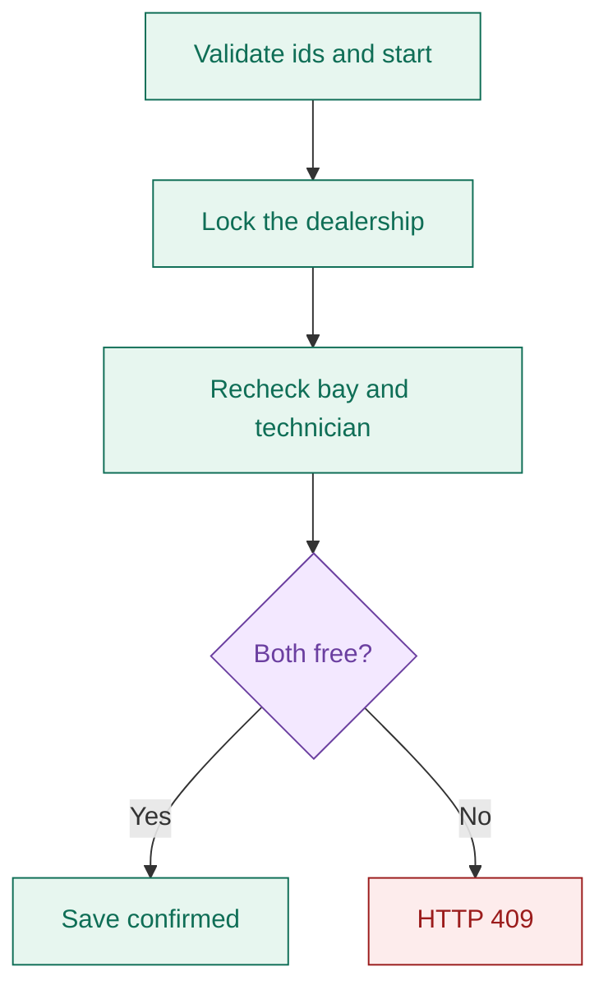
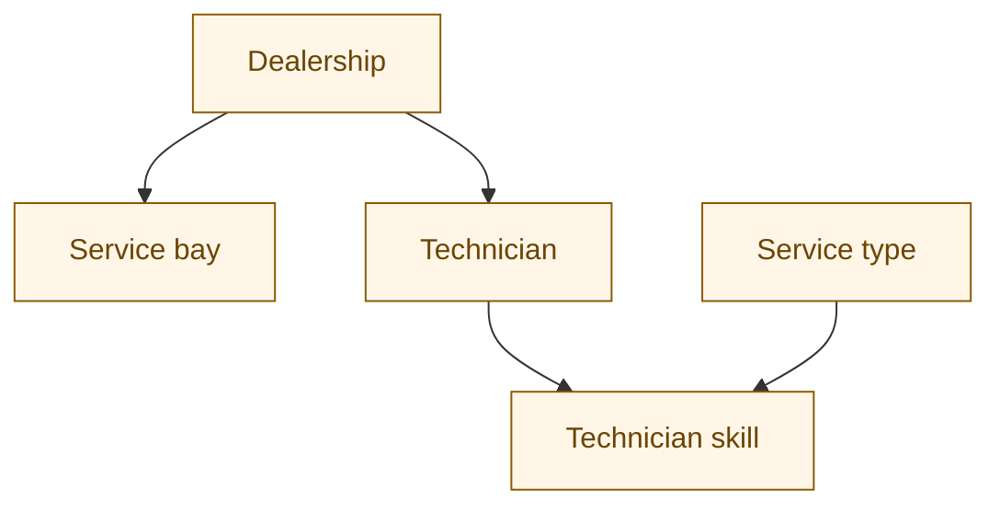
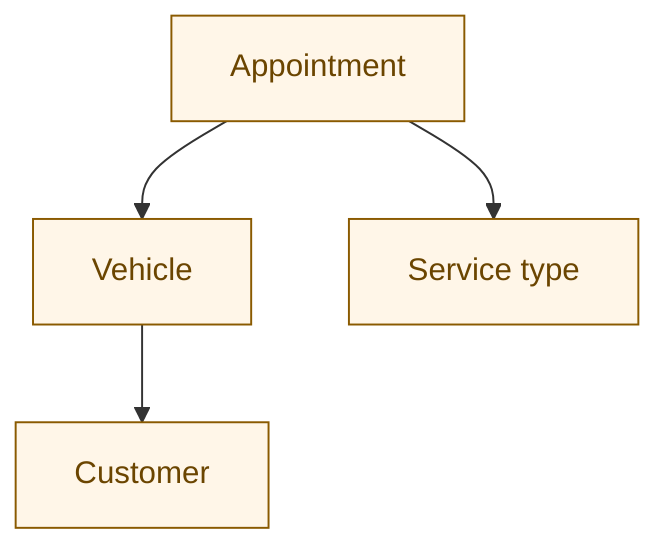

# System Design — Unified Service Scheduler

The shipped demo is a modular monolith: a React client, a NestJS API, and PostgreSQL, packaged as one Docker image. This page describes the implemented system and the production controls required to operate it safely. Requirements that are designed but not implemented in the challenge build are labelled **Production design**.

The running demo is [https://keyloop-service-scheduler-29lh.onrender.com/](https://keyloop-service-scheduler-29lh.onrender.com/). `GET /api/health` on that host returns `{"status":"ok"}`.

## 1. Purpose

A service advisor books a vehicle into a dealership for a timed service. The system must show whether a bay and a qualified technician are free, then confirm the appointment without giving the same bay or the same technician to two overlapping bookings.

## 2. Context

The advisor uses a browser. The scheduler application is the only system in the demo. PostgreSQL is the system of record for confirmed bookings.

**Legend.** Blue is a person, green is the application, amber is stored data. Later diagrams use the same colors. Purple is a decision. Red is a rejected booking.

## 3. Scope

In scope for the demo:

- Choose a dealership, a seeded vehicle, a service type, and a timezone-aware start.
- Advisory availability for that dealership, without holding the bay or the technician.
- A confirmed appointment stored in PostgreSQL.
- A list of appointments in the UI, refreshed after a successful booking.

The challenge build does not yet enforce business hours, breaks, bay suitability, appointment edits, cancellations, holidays, authentication, authorization, or personal-data controls. Their required behavior is specified in [section 10](#10-production-requirements-and-controls), so they can be implemented without making product-policy decisions in code.

## 4. Architecture

One Node 22 process on Render in Singapore serves the API and the built React assets. The advisor and PostgreSQL sit outside that process. Inside it, NestJS accepts the request, the scheduler owns the booking rules, and TypeORM talks to PostgreSQL.

<iframe src="{{ '/diagrams/scheduler-runtime.html' | relative_url }}" title="Scheduler runtime" style="width: 100%; height: 1080px; border: 1px solid #e6e6e6; border-radius: 8px;"></iframe>

[Open the runtime diagram]({{ '/diagrams/scheduler-runtime.html' | relative_url }}) if the frame is too small. The figure has one path: advisor, React UI, Render web, the Node process, NestJS API, scheduler, TypeORM, then PostgreSQL. The Render region wraps the web service and the process. The Node process is the inner trust boundary. Supporting limits, including no authentication and the dealership lock, are on the diagram cards rather than extra arrows.

| Part | Responsibility |
| --- | --- |
| React | Appointment entry, availability, confirmation, and history. |
| TanStack Query | Request state, and cache invalidation for the appointment list after a confirmed booking. |
| NestJS | Validate the request body and call the scheduler service. |
| TypeORM | Map dealerships, customers, vehicles, service types, bays, technicians, technician skills, and appointments. |
| PostgreSQL | Store confirmed bookings. Serialize booking transactions. |
| Docker | Same image locally (`docker compose up --build`, port 3000) and on Render. |

A modular monolith is the chosen shape: it avoids network calls between services for a small challenge, and it keeps a UI layer, an API layer, and a service layer. NestJS supplies dependency injection and the REST surface. React and TanStack Query keep remote state out of the component's own bookkeeping. PostgreSQL supplies transactional correctness.

## 5. Booking

Desired start is an instant. The UI reads a local date-time and sends UTC via `Date.toISOString()`. The service treats the stored `timestamptz` values as instants.

Overlap is half-open. An existing confirmed appointment conflicts when `existing.start < requested.end` and `existing.end > requested.start`. Touching endpoints do not conflict: 10:00–11:00 may sit beside 11:00–12:00. The unit test in `apps/api/src/scheduler.service.spec.ts` covers that pair of cases. Only rows with status `confirmed` at the same dealership are considered.

Duration comes from the service type. The requested end is start plus `durationMinutes`. Candidate resources are active bays at that dealership, and active technicians at that dealership who have a skill row for that service type. Stable first-fit is the intended demo assignment policy: choose the lowest-id free bay and lowest-id qualified free technician. It is deterministic and easy to explain, although a production rollout should measure load distribution before retaining it.

A confirmed booking follows the single path on the runtime diagram. The advisor submits from the React UI, Render delivers the request to the Node process, NestJS calls the scheduler, and TypeORM writes PostgreSQL. The diagram opens in Live, so the path plays on load. Choosing Still keeps that choice for the next visit.

<iframe src="{{ '/diagrams/scheduler-runtime.html' | relative_url }}" title="Booking on the scheduler runtime" style="width: 100%; height: 1080px; border: 1px solid #e6e6e6; border-radius: 8px;"></iframe>

[Open the runtime diagram]({{ '/diagrams/scheduler-runtime.html' | relative_url }}) if the frame is too small.

1. The advisor chooses dealership, vehicle, service type, and start.
2. Availability loads the service duration and the candidate bays and qualified technicians. It does not take a lock and it does not insert a row. The result is advisory.
3. The overlap test above decides whether each candidate is free for the whole interval.
4. Booking opens a `READ COMMITTED` transaction and takes `pg_advisory_xact_lock(dealershipId)`. The lock is held until the transaction ends, so two bookings for the same dealership cannot both pass the recheck.
5. Inside the lock the service loads the vehicle, the service type, and the free bay and technician again. It refuses the booking when either resource is missing.
6. On success it inserts one appointment: the vehicle's customer, the chosen bay and technician, the computed end, and status `confirmed`. The UI then invalidates the appointment query and reloads the list.

A conflict throws NestJS `ConflictException` with the message `Technician or service bay unavailable for entire appointment`, which the API returns as HTTP 409. Unknown dealership, vehicle, or service type is HTTP 404. Identifiers must be integers greater than zero. `startAt` must be a future ISO 8601 instant with `Z` or an explicit offset; optional seconds and fractional seconds are accepted, including the millisecond form produced by `Date.toISOString()`.

The availability response includes `available`, `startAt`, `endAt`, `durationMinutes`, `serviceBay`, and `technician`. Either resource is null when that side is busy. `available` is true only when both are present.

## 6. Data

Schema changes use versioned TypeORM migrations with `synchronize: false` in every environment. The baseline migration is idempotent so it can adopt the original demo database as well as create an empty database. Entity relations and database foreign keys use restrictive deletion for booked business records and cascading deletion only for technician-skill join rows. Check constraints require positive service duration, a positive appointment interval, and a known appointment status. Partial interval indexes support the overlap query.

An appointment also stores `dealershipId`, `serviceBayId`, `technicianId`, `startAt`, `endAt`, and `status`. The customer on the appointment is copied from the vehicle at booking time. The advisor does not pick a customer separately.

Seed data is illustrative and is inserted only when the dealership table is empty (`apps/api/src/seed.ts`):

- Two dealerships, both in Ho Chi Minh City.
- One customer, `demo@example.com`, who owns both sample vehicles.
- Three service types: 60, 90, and 120 minutes.
- Two active bays and two active technicians per dealership. Each technician is skilled for every service type.

## 7. Interfaces

The controller is `apps/api/src/scheduler.controller.ts`. JSON field names on a booking body are `dealershipId`, `vehicleId`, `serviceTypeId`, and `startAt`. Extra fields are rejected.

| Method | Path | Behavior |
| --- | --- | --- |
| `GET` | `/api/health` | Runs `SELECT 1`; returns `{"status":"ok","database":"ok"}` only when PostgreSQL is reachable. |
| `GET` | `/api/metrics` | Prometheus text for request counts, HTTP 5xx counts, and request-duration histograms. |
| `GET` | `/api/catalog` | Dealerships, customers, vehicles, and service types. |
| `POST` | `/api/availability` | Advisory check. No lock and no insert. |
| `POST` | `/api/appointments` | Book inside the dealership lock, or HTTP 409. |
| `GET` | `/api/appointments` | Stored appointments, oldest start first. The query does not filter on status. Optional `dealershipId` query. |

The UI loads the catalog and the full appointment list. It does not pass `dealershipId`. The history panel shows up to seven appointments, newest first, with vehicle, bay, and technician ids.

Example body from the README: `{"dealershipId":1,"vehicleId":1,"serviceTypeId":1,"startAt":"2026-12-01T09:00:00+07:00"}`.

## 8. Deployment and observability

`Dockerfile` builds the web app and the API, then runs `node dist/main.js` on port 3000 with the React build in `public`. Compose starts PostgreSQL 17 and the app. The app waits until Postgres is accepting connections.

Render runs that image as the web service `keyloop-service-scheduler` in Singapore on the free plan (`render.yaml`). The platform health check uses `/api/health`. `DATABASE_URL` is set in the Render environment to the database internal URL and is not stored in this repository. When `DB_SSL=true`, the client uses TLS and does not verify the server certificate. `render.yaml` does not set that variable.

Every API response carries `x-correlation-id` and W3C `traceparent`. A valid caller correlation id is preserved; otherwise the API creates one. Completion logs are structured JSON and include correlation id, trace id, span id, route, status, and duration. The process exposes Prometheus-format request, error, and duration metrics at `/api/metrics`. These in-memory counters reset on restart, so production must scrape them into durable monitoring.

`GET /api/health` is a readiness signal because it executes `SELECT 1` against PostgreSQL. Process/container state remains the liveness signal; liveness must not depend on the database or an outage could cause a restart loop.

**Production alert policy.** Page the on-call engineer when readiness fails for 3 consecutive minutes, HTTP 5xx exceeds 2% for 5 minutes with at least 50 requests, booking p95 exceeds 500 ms for 10 minutes, or no successful booking is observed during a known busy period. Ticket-level alerts cover monthly SLO burn, backup failure, capacity above 70%, and certificate/secret expiry within 14 days. Every page links to a runbook and includes region, deployment version, correlation ids, and a dashboard time range.

CI on GitHub Actions runs the Jest suite, the TypeScript build, and a Docker image build. A second workflow monitors the Render service; Render itself deploys pushes to `main`.

## 9. Decisions

| Topic | Decision |
| --- | --- |
| Shape | Modular monolith. One deployable process. |
| Contention | One PostgreSQL advisory transaction lock per dealership, then a recheck. Chosen as a direct control for this small service, aimed at the race between the advisory check and confirm. |
| Isolation | `READ COMMITTED` plus that lock. The lock, not the isolation level alone, stops two overlapping confirms for one dealership. |
| Overlap | Half-open interval. Adjacent appointments are allowed. |
| Assignment | Lowest id among active, skilled, non-overlapping resources. |
| Schema changes | Versioned TypeORM migrations; `synchronize` is disabled. |
| Time | Instants in `timestamptz`. The client converts local input to UTC. |

## 10. Production requirements and controls

The following targets define the production acceptance criteria. They are not claims about the free-tier demo.

### Service levels, recovery, and capacity

- **Latency:** monthly p95 below 300 ms for catalog and availability, below 500 ms for booking, and p99 below 1 second, measured at the API edge and excluding client network time.
- **Availability:** 99.9% monthly for availability and booking APIs. Planned maintenance announced at least 48 hours ahead is excluded; database and hosting failures are included.
- **Recovery:** PostgreSQL point-in-time recovery with encrypted daily backups, a recovery point objective of 5 minutes, and a recovery time objective of 30 minutes. Perform and record a restore exercise every quarter.
- **Capacity:** initial sizing is 50 dealerships, 200 concurrently active advisors, 20 booking attempts per second for a 5-minute burst, and 5 million retained appointments. Load tests must prove the latency targets at 150% of this baseline. Scale up at 70% sustained database CPU, connection-pool use, or storage IOPS, and reassess advisory-lock contention by dealership.

### Scheduling policy

- Each dealership has an IANA timezone, weekly opening intervals, and dated closure intervals for holidays or exceptional closures. The entire appointment must fit in one open interval after conversion from the submitted instant; daylight-saving transitions use the timezone database.
- Technician breaks, training, leave, and bay maintenance are half-open unavailability intervals. They participate in the same overlap calculation as confirmed appointments.
- Service types declare required bay capabilities; bays declare their capabilities. A bay is a candidate only when it contains every capability required by the service.
- Rescheduling uses `PATCH /appointments/:id` with an `If-Match` version. It takes the dealership lock, validates the new interval, reallocates resources using the normal policy, and updates atomically. A stale version returns 412 and unavailable resources return 409.
- Cancellation uses `POST /appointments/:id/cancel` with a reason and idempotency key. It takes the dealership lock, changes `confirmed` to `cancelled`, releases the slot immediately, and returns the existing result on retries. Confirmed appointments are never physically deleted.
- Every create, reschedule, and cancellation writes an immutable audit event containing actor, dealership, prior and new values, timestamp, correlation id, and reason.

### Identity, authorization, and personal data

- Advisors authenticate with the organization's OpenID Connect provider using Authorization Code with PKCE. The API validates short-lived signed access tokens by issuer, audience, expiry, and key id. Service-to-service clients use separate credentials; shared API keys are prohibited.
- Roles are `advisor` (read and create within assigned dealerships), `service-manager` (also reschedule and cancel), and `platform-admin` (configuration only). Dealership ids come from token scopes and are checked on every query and mutation; a body or query parameter cannot expand access.
- TLS is required in transit. PostgreSQL volumes and backups are encrypted at rest. Secrets live in the deployment secret store and rotate at least every 90 days.
- Customer name, email, registration, and appointment history are personal data. They are excluded from application logs and metrics, masked in support views, and available only to dealership-scoped roles. Production responses return only fields needed by the current screen.
- Retain appointments and audit records according to the approved regional policy, then delete or irreversibly anonymize personal fields. Fulfil access and erasure requests through audited workflows, subject to legal retention holds. Backups expire on the same documented schedule.
- Security events include failed authentication, denied dealership access, privilege changes, bulk export, and unusual lookup volume. Send them to the centralized security log with tamper-resistant retention.

### Verification status

The automated suite now covers half-open adjacency, UTC milliseconds, explicit timezone offsets, rejection of offset-free local time, and two simultaneous booking attempts for one resource pair. The concurrency test expects exactly one confirmation and one conflict. A production pipeline must additionally run the same scenario against PostgreSQL, migration up/down tests, authorization tests, restore drills, and the capacity test above.

## 11. GenAI collaboration

AI was used to outline the architecture and to draft the initial data model, layer boundaries, API, concurrency approach, Docker setup, documentation, and React UI. Generated output stays subject to engineering review. The review focus is the race between availability and confirmation, transaction isolation, resource overlap, date-time validation, input validation, the Postgres connection, and deployment verification.

Per-dealership advisory transaction locks are the contention control adopted for this service. Failed installs, deployment errors, and later changes belong in the presentation as open items, not as validated behavior.

## Source map

| Claim | Source |
| --- | --- |
| Layers, lock, half-open overlap, advisory check, 409, health, demo limits | This design, checked against `apps/api/src/scheduler.service.ts` and `scheduler.controller.ts` |
| Entities and foreign-key relations | `apps/api/src/entities.ts` |
| Migrations and static files | `apps/api/src/app.module.ts`, `apps/api/src/migrations/` |
| Seed contents | `apps/api/src/seed.ts` |
| UI behavior | `apps/web/src/App.tsx` |
| Date, adjacent-slot, and concurrent-booking tests | `apps/api/src/scheduler.service.spec.ts` |
| Image and local runtime | `Dockerfile`, `docker-compose.yml` |
| Render service, region, health path | `render.yaml`, `README.md` |
